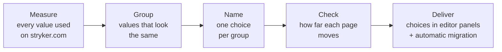
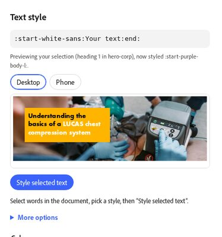
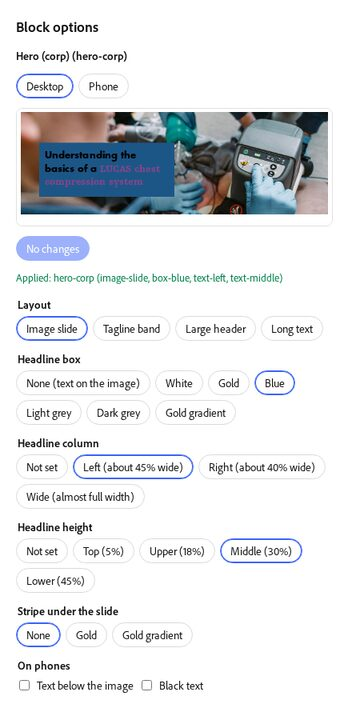
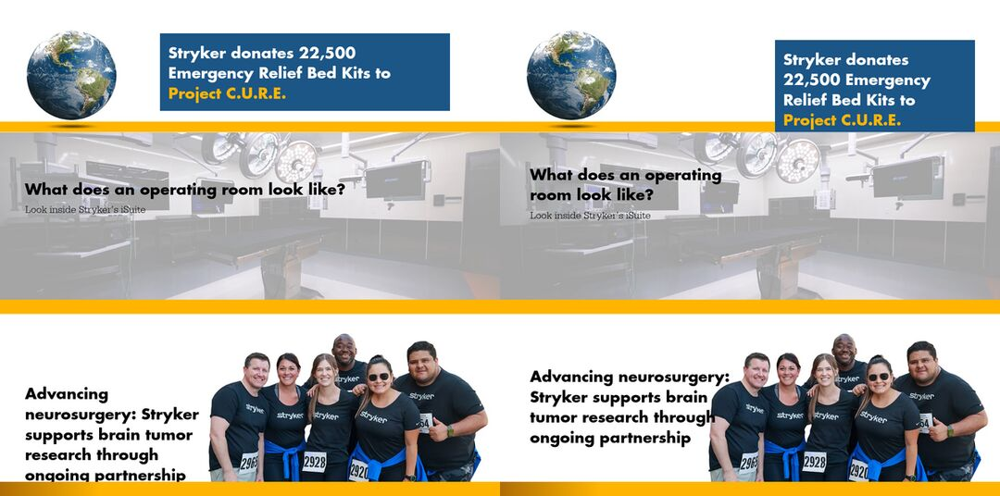

# Same look, fewer choices: standardising stryker.com on the new site

*A walkthrough for business, content and design teams. No technical knowledge needed.*

> **Using this as a wiki page:** copy this file into the wiki and upload the three images in
> [`img/`](img/) next to it (`text-style-panel.jpg`, `block-options-panel.jpg`,
> `before-after-positions.jpg`). The page uses no other files.

---

## 1. The story in one minute

| | |
|---|---|
| **The situation** | On www.stryker.com, authors could type *any* number or colour for how a banner, a box or a word looks. Over the years this produced **hundreds of slightly different values** for what is really the same design. |
| **The risk** | Copying all of them to the new site means hundreds of special cases: harder to author, slower to migrate, costly to maintain, and the site keeps drifting apart page by page. |
| **What we did** | We measured what stryker.com *actually* uses, kept its look, and turned the free values into a **small set of named choices**, picked from **two panels** in the editor. |
| **The result** | Pages look the same or almost the same as today. Authors choose from plain words such as *Gold*, *Left*, *Upper*, with a live preview. |

---

## 2. The problem, in numbers

We counted every value in the stryker.com content export: 3,732 pages and shared fragments.

| What authors could set freely | Different values found |
|---|---|
| Position of a banner's headline | **189** combinations across 478 banners |
| Spacing around a text block (top / bottom padding) | **31 / 49** values |
| Spacing inside a banner's headline box | **9–21** values per side |
| Background colours of text, headlines and panels | **26–27** written values each (often the same colour written differently) |
| Font sizes in text and headings | about **20** size settings |

Most of these differences are invisible to a visitor (for example 17% versus 18% from the
top), but every one of them has to be built, tested and maintained.

---

## 3. Our approach

Three principles:

1. **Evidence, not taste.** Every choice is the most common value on stryker.com for its group.
2. **Keep the look.** We measure how close each page stays and list the ones that move more.
3. **Fewer, named choices.** Authors pick words, not numbers or codes.

---

## 4. Part 1: styling words inside a line (Text style panel)

**What it is for:** a gold word in a white headline, a larger serif phrase, a box around one line.

**How an author uses it**

1. Select the words in the page.
2. Pick a colour, font, size or spacing in the **Text style** panel.
3. Check the **live preview**, which shows the words inside their real banner, on desktop or phone.
4. Click **Style selected text**.

**Choices**

| Choice | Options |
|---|---|
| Colour | Blue, gold, purple, teal, grey, white, light grey, black, mid grey, dark gold, pale grey |
| Font | Serif (Egyptienne), Sans (Futura), Body (Humanist) |
| Size | Small 0.8×, Large 1.25×, X-large 1.5×, XX-large 1.75× (relative to the text around it) |
| Spacing | 5, 10, 15, 20 or 30 px of padding or margin, on any side |

**Why it is better than before:** the first approach stored styles as visible codes in the
text (`[[gold]word]`). Search engines and link previews could read those codes. The new
approach stores them in a way the page delivers as **clean text**, so search engines see only
the words.

---

## 5. Part 2: banner options (Block options panel)

**What it is for:** choosing how a banner looks (box colour, where the headline sits, the
stripe, phone behaviour) without remembering option names.

**How an author uses it**

1. Click in the banner (in the visual editor), or select its name row (in the document editor).
2. Pick the options and check the preview.
3. Click **Apply options**.

**Choices for the banner (hero)**

| Choice | Options | What it means |
|---|---|---|
| Layout | Image slide, Tagline band, Large header, Long text | The four banner designs on stryker.com |
| Headline box | None, White, Gold, Blue, Light grey, Dark grey, Gold gradient | The box behind the headline (*None* = text straight on the image) |
| Headline column | Left, Right, Wide | Left column (about 45% wide), right column (about 40%), or almost full width |
| Headline height | Top, Upper, Middle, Lower | How far down the headline starts (5%, 18%, 30%, 45%) |
| Stripe under the banner | None, Gold, Gold gradient | The coloured band under the image |
| Title colour | Gold, White, Light grey, Blue | The colour of the bold headline lines |
| Subline colour | Gold, White, Light grey, Blue | The colour of the plain headline lines |
| On phones | Text below the image, Black text | How the banner behaves on a phone |
| Tagline band colour | Gold, Purple gradient | The title band at the top of a page |

---

## 5b. Where each style goes: three layers, so we never run out of options

Authors on stryker.com styled **50,437 runs of text** (a colour, font or size on some words or
a whole line). We measured them all:

- **73% style a whole line**, not a few words.
- The most common word-level looks are **Futura bold** (always used with bold) and **gold**.
- **Italic is used for real italics** (journal names, quotes, "2-minute read") on 153 pages, so
  it cannot simply mean "gold" everywhere.

So every style goes in the first of three layers that can carry it:

| Layer | For | Examples | Authors see codes while editing? |
|---|---|---|---|
| **1. Formatting** | The few most common word looks, the same on every page of the site | **Bold** = Futura bold · **Heading + italic** = gold · **Bold + italic** = gold bold | No: it is normal bold / italic |
| **2. Settings of the line's container** | Whole-line looks | Banner **title / subline colour** · paragraph size or serif (section style) | No: chosen in a panel |
| **3. Text style markers** | The rare word looks that are left | A blue word in a paragraph, one larger word | Only while that field is being edited |

**The rules are site-wide**, not block by block: italic in any heading is gold, italic in a
paragraph is a real italic, on every page.

**Why we never run out:** layer 1 deliberately has only two or three meanings, so formatting
stays predictable. Layer 2 grows with blocks and sections, not with formatting combinations.
Layer 3 has no limit: any new look becomes one more choice in the Text style panel.

**Effect on the banner samples:** of 14 imported banners, **12 have no codes at all**; only two
words (a gold "Project C.U.R.E." in a white title, a light grey line in a gold one) keep a
Text style marker.

| Gold text across the site (not counting banners) | Uses | Pages | Layer |
|---|---|---|---|
| In headings | 950 | 419 | 1: heading + italic |
| Whole banner lines | (in banners) | | 2: title / subline colour |
| Words inside body paragraphs | 1,726 | 388 | 3: Text style panel |

---

## 6. How close is it to stryker.com?

| Setting | On stryker.com | With named choices | How close |
|---|---|---|---|
| Headline position | 189 combinations | 3 columns × 4 heights | **93%** of banners within 10% of today; 72% within 5% |
| Headline box colour | 9 colours | 7 choices | **98%** of boxes keep their colour |
| Box inner spacing | 9–12 values per side | 1 standard spacing | Looks consistent; a few boxes are slightly larger or smaller |
| Tagline colour | 2 visible colours | 2 choices | **100%** |

**Banners that move more**, shown side by side (left: stryker.com values, right: named choices):

- **Top:** the box was unusually wide; in the right column it wraps onto one more line. A
  headline that would run past the bottom of the banner now moves up so it always stays
  inside the banner.
- **Middle:** wide text now sits in the left column, on two lines.
- **Bottom:** the old extra margin pushed the headline off the bottom; it now fits. The
  standard left column is a little wider than this banner's, so the text comes closer to
  the photo.

These are the cases to review. If wider or narrower columns are wanted, one more column
choice can be added.

---

## 7. What we did not carry over, and why

| stryker.com setting | Pages | Decision |
|---|---|---|
| *Information for healthcare professionals* placed **inside the banner corner** | 12 | Use the existing **band at the top of the page** everywhere: one consistent place, switched on per page |
| Page navigation **over** the banner | 17 | Not visible on today's pages, so there is nothing to carry over |
| Extra space under a banner | 6 | Standard spacing |
| Banner text colour white / gold / dark grey | 4 | Authors colour words with the Text style panel |
| Rare purple and blue gradient headline boxes | 2 | Use *Dark grey* |
| Hidden taglines | 11 | Hidden on stryker.com, so not migrated |
| Rotating carousels (several slides, autoplay) | 17 | A separate component, handled separately |

---

## 8. Proposed next (awaiting sign-off): one scale for font sizes and spacing

| Area | Today | Proposed | Effect on pages |
|---|---|---|---|
| Font sizes (text, headings, words in a line) | about 20 settings | **5 sizes**: 0.8×, 1.25×, 1.5×, 1.75×, 2× | The most used sizes stay exactly the same; text at 2.5× becomes 2× |
| Spacing (padding and margin) | 16–49 values per setting | **4 steps**: none, 3%, 5%, 10% | **97%** of spacing stays within 2% of today |
| Background colours | about 27 written values | **8 brand colours** + none | 95%+ unchanged |

Pages already on the new site keep rendering as they are; new and re-imported pages use the scale.

---

## 9. Pros and cons

| Pros | Cons |
|---|---|
| **Consistent look:** the same element looks the same on every page | **Not pixel-identical:** a small share of elements move or resize slightly |
| **Easier authoring:** a few named choices with a live preview | **Sign-off needed** on the outliers (section 6) |
| **Faster migration:** source values map to the nearest choice automatically | **Less freedom:** an in-between value must be requested and added on purpose |
| **Cheaper upkeep:** a design change is made once and applies everywhere | **Short transition:** old and new names coexist until old content is converted |
| **Search friendly:** styled words reach search engines as clean text | |

---

## 10. Decisions we need from the business

1. **Approve the banner choices** (section 5) and the outliers (section 6).
2. **Healthcare-professional notice:** use the page-top band everywhere (section 7)?
3. **Approve the font-size and spacing scale** (section 8).
4. **Confirm the formatting rule** "heading + italic = gold" (section 5b), to be added to the
   authors' formatting conventions page.

---

## 11. Questions people ask

**Will visitors notice?** On most pages, no. The values that move are listed in section 6
and can be reviewed side by side.

**What if a page really needs something different?** We add a new named choice on purpose,
so every page can reuse it, rather than a one-off value.

**Do authors need to learn codes?** No. Both panels show plain words and a preview, and write
everything for them.

**What happens to pages already migrated?** They keep working and look the same; nothing
needs to be redone.

---

## Glossary

| Term | Meaning |
|---|---|
| Banner / hero | The large image with a headline at the top of a page |
| Headline box | The coloured box behind a banner's headline |
| Tagline band | The coloured title band at the top of some pages |
| Text style | Colour, font, size or spacing applied to a few words |
| Block options | The settings of a component such as a banner |
| Visual editor | Experience Workspace, where authors edit the page as it looks |
| Document editor | DA, where authors edit the page as a document |
