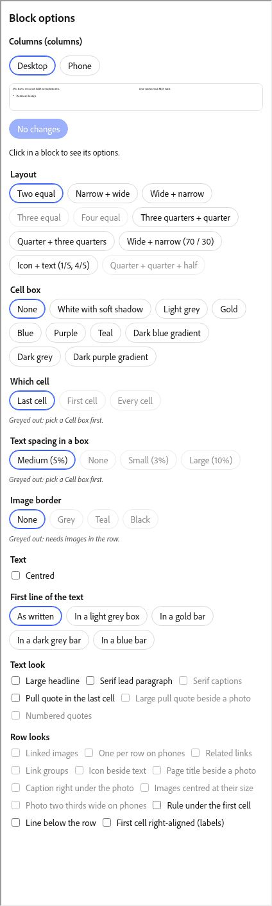

# About this guide

This guide is for the business, content and design teams. It explains, without technical terms,
how we turned the many free settings of www.stryker.com into a short list of named choices on the
new site, and how we decided which values belong together. It covers **all 22 blocks** of the
stryker.com package. The **Columns** block (rows of two, three or four cells side by side) is the
worked example for the method (sections 1 to 7); section 10 compares every block at a glance, and
section 11 explains, block by block, what changed in practice and what the business needs to decide.

> In one sentence: we measured what every page of stryker.com really shows, grouped the values that
> look the same to a visitor, gave each group one plain name, and checked how close every page stays.

# 1. Why we standardised

On stryker.com, authors could type **any** number or colour into a component: the spacing inside a
box in percent, a colour code, a font size, the position of a headline. Over the years this produced
hundreds of slightly different values for what is really the same design.

| What authors could set freely | Different values on stryker.com today | Named choices on the new site |
|---|---|---|
| Spacing inside a box, top | **31** values | **4** steps: none, small, medium, large |
| Spacing inside a box, bottom | **44** values | the same **4** steps |
| Font size | **49** values | normal + **6** text sizes, **4** headline sizes |
| Font | **9** ways of writing it | **3** fonts: Futura, Egyptienne, Humanist |
| Text colour | **27** values | **8** brand colours + **4** more Stryker colours (black, mid grey, dark gold, pale grey) |
| Box / background colour | **25** values | **10** named colours |
| Image border colour | **12** values | **3**: grey, teal, black |
| Column widths | **5** patterns | **5** layouts |

*Measured on the 2,340 live pages of the migration list.*

Most of these differences are invisible to a visitor: a box with 4% spacing and one with 5% look
the same. But every distinct value has to be built, tested and maintained, and every new page
drifts a little further from the others. Copying them all would make the new site harder to author,
slower to migrate and more expensive to run.

# 2. How we did it: five steps

| Step | What we did |
|---|---|
| **1. Measure** | We opened **every page** of stryker.com on a desktop and on a phone, with tabs and accordions opened, and recorded what is really **shown**: every spacing, size, colour and width, and how often each one is used. We also read the content export, to know what authors set. |
| **2. Group** | We put together the values that look the same, or almost the same, to a visitor (the next section explains exactly how). |
| **3. Name** | Each group gets **one choice with a plain name**: *Medium spacing*, *Gold box*, *Last cell*. The value of each choice is the **most common value on stryker.com** in its group, so most pages do not move at all. |
| **4. Check** | We measured how far every page moves with the named choices, and listed by address the pages that move more, for review. |
| **5. Deliver** | The choices appear in the editor's **Block options panel**, with a live preview; the migration writes them automatically for every page. |

Four principles guided every decision:

1. **Evidence, not taste.** Every choice comes from what stryker.com uses most. The live site is the source.
2. **Keep the look.** We measure how close each page stays and list the pages that move more.
3. **Fewer, named choices.** Authors pick words, not numbers or codes.
4. **One vocabulary.** A colour has the same name in every block: *Gold* is the same gold in a banner, a box, a column or a card.

# 3. How close values were grouped

This is the heart of the method. For each kind of setting we looked at all the values in use,
counted how often each appears, and placed a small number of **steps** where the values naturally
gather. Every value then joins the **nearest step**, as long as the difference is too small to see.

## 3.1 Spacing: steps of none, 3%, 5% and 10%

Spacing inside a box is written in percent of the box width. Here is what the Columns block uses
today for the space above the text in a box (483 boxes):

| Spacing today | Boxes | Joins the step |
|---|---|---|
| 5% | 104 | **Medium (5%)** |
| 3% | 101 | **Small (3%)** |
| 2% | 62 | **Small (3%)**, 1 point away |
| 0% | 43 | **None** |
| 15% | 25 | more than 2 points from any step: listed for review (proposal: **Large**) |
| 20% | 22 | listed for review (proposal: **Large**) |
| 17 other values | the rest | the nearest step when within 2 points, otherwise listed |

**The rule:** a value joins a step when it is **within 2 points** of it: 2% becomes 3%, 4% becomes
5%, 7% becomes 5%, 8% and 12% become 10%. At the sizes used on the site, a 2-point difference is a
few pixels, which a visitor does not notice. The four steps were placed where the values already
gather: 5%, 3% and 0% are three of the four most used values on their own, and 10% collects the
larger ones.

**The result for Columns:** 89% to 100% of boxes keep their spacing, depending on the side.

**Spacing around a box** (outer margins) is different: stryker.com uses large and sometimes negative
values that pull a box over the content above it. Here there is **no setting** at all on the new
site; every block keeps one standard gap. 77% to 96% of boxes are within 2 points of that gap; the
others, such as 49 column rows indented by 20%, are listed for review.

## 3.2 Font sizes: multiples of the text around them

Font sizes on stryker.com are mostly written as a multiple of the normal text: 1.25 times, 1.5
times, and so on. In Columns, the most used sizes are:

| Size today | Uses in Columns | Choice |
|---|---|---|
| 1.25 × normal | 4,580 | **Large (1.25×)** |
| 1.5 × | 1,432 | **X-large (1.5×)** |
| 1.75 × | 489 | **XX-large (1.75×)** |
| 2 × | 430 | **2×** |

**The rule:** a size joins a step when it is **within about 10%** of it (1.3× becomes 1.25×).
The steps are 0.8×, 1.25×, 1.5×, 1.75×, 2× and **2.5×**: 2.5× is kept because stryker.com uses it
753 times (more than plain 1×), mostly for big figures in boxes. Larger sizes are not used as text
sizes and take the nearest step.

**Large headlines** grow with the width of the screen on stryker.com, in **17 different sizes**
(from 1% to 9% of the width). They are grouped the same way, into **4 headline sizes**:

| Headline size today (% of the width) | Uses | Joins |
|---|---|---|
| 1 and 1.5 | 862 | **S (1.5)** |
| 2 | 787 | **M (2)** |
| 2.5, 3 and 3.5 | 1,245 | **L (3)** |
| 4 to 9 | 690 | **XL (4.5)** |

Each size joins the nearest step, by proportion. Of the sets of four we compared, this one keeps
the most headlines: **73%** are within 12.5% of their step and **96%** within a quarter of a step.

**The result:** 97% of the text sizes in Columns stay the same.

## 3.3 Colours: the exact brand colours, no blending

Colours are **not** grouped by closeness. A brand colour is either right or wrong, so the new site
uses the **exact** stryker.com values. What we did group is the **same colour written in different
ways**: stryker.com writes its gold as `#ffb500` in some places and as `rgb(255,181,0)` in others,
which a visitor cannot tell apart.

| Box colours | Count |
|---|---|
| Written values on stryker.com | 27 |
| Real colours once duplicates are merged | 14 |
| Named colours on the new site | **10**: white with shadow, light grey, gold, blue, purple, teal, dark grey, and three gradients |

For **text**, the 8 brand colours (blue, gold, purple, teal, navy, grey, white, light grey) are
joined by four more Stryker colours that authors use and that stryker.com's own components use
too: **black** (1,678 uses; the components' *text-black* option), **mid grey** #b2b4ae (132; image
borders and rules), **dark gold** #af6d04 (71; the start of the gold gradient, chart colours) and
**pale grey** #dfe1de (51; the accordion background). A charcoal (#323232, 93 uses) appears only as
a code typed by authors, not in any component, so it is not a choice; its uses are listed for review.

The few rare box colours that remain (an orange, a pale grey, a lighter grey and a mid grey) are
listed by page for the business to decide; nothing is blended silently.

**The result:** 98% to 100% of boxes keep their exact colour.

## 3.4 Column widths: the five patterns already in use

stryker.com builds rows on a grid of twelve columns, so its column widths come in a few fixed
patterns. All 2,419 column rows use one of five: **two equal**, **narrow + wide**, **wide + narrow**,
**three equal** and **four equal**. These become the five layouts, unchanged (**100%** kept). Three
less common widths that real pages use (three quarters + quarter, its mirror, and icon + text) are
kept as extra layouts.

## 3.5 What "kept" means

Throughout this guide, **kept** is the share of uses whose look stays the same or almost the same:

- spacing within 2 points of a step,
- a font size within about 10% of a size step,
- a colour that is one of the named colours.

# 4. Where each setting lives

Not every setting belongs in the same place. We used four layers, so each choice is made once, in
the most natural spot:

| Layer | For | Example | Who chooses |
|---|---|---|---|
| **1. Layout** | the structure of a block | Columns *two equal* or *narrow + wide* | the author, when adding the block |
| **2. Block options** | how a block looks | box colour, which cell, spacing, border, alignment, the row's *Text look* | the author, in the **Block options panel** |
| **3. Section styles** | the background and arrangement of a whole section | a grey band behind several rows | the author, in the section settings |
| **4. Text style** | a few words inside a text | a gold name, one serif sentence, a box around one line | the author, with the **Text style panel** |

**A simple rule for authors:** if it changes the **whole row**, it is in Block options; if it
changes **a few words**, it is in Text style. For example, "large headline type" for a whole row is
one click in Block options, while making one name gold is done in Text style. Both use the same
sizes and colours, so they always match.

# 5. What authors see

Authors select a block and open the **Block options panel**. It shows the block's choices grouped by
topic (Layout, Cell box, Which cell, Spacing, Image border, Text look, Row looks), with a **live
preview** of the block.

The panel also reads the selected block and **greys out the choices that would do nothing** for it.
Hovering a greyed choice says why: *"needs images in the row"*, *"needs 3 cells (this row has 2
cells)"*, *"pick a Cell box first"*. So an author never picks an option that has no effect, and
learns what each option is for. A choice the block already has always stays available, so it can be
removed.

{height=15cm}

# 6. How close the new site stays

| Setting | With the named choices | Kept |
|---|---|---|
| Box colours (all blocks) | 10 colours | **98%** |
| Spacing inside boxes and cells | 4 steps | **96% to 99%** |
| Font sizes | 6 text + 4 headline sizes | **96%** |
| Fonts | 3 fonts | **99%** |
| Image borders | 3 colours | **95%** |
| Column layouts | 5 layouts | **100%** |
| Phone behaviour of columns | as today (every row stacks in order) | **100%** |

The pages that move more are listed by address in the block chapters, so the business can review
them one by one. The largest group is outer spacing (margins), which becomes one standard gap.

**How we check it:** for each block we build a review page with a real stryker.com row for every
layout and choice, next to a link to its source page. A comparison measures every piece of text in
those rows (font, size, weight, colour, background) on both sites and lists the differences, so each
one is either fixed or explained.

**Columns result:** on its review page, **48 of the 50 comparable rows match stryker.com exactly**
in text colour, size and font, using only the limited sets above. The other 2 have a headline
between two steps, which joins the next step up, as the grouping intends.

# 7. Columns: what changed in practice

| Before | After |
|---|---|
| Any column ratio, set by component type | **5 layouts** (+ 3 extra widths real pages use) |
| Any box colour in any cell, written as a code | **Cell box**: 10 named colours, and **Which cell**: first, last or every cell |
| Any spacing in percent, per side | **Text spacing in a box**: none, small, medium, large |
| Any image border colour | **Image border**: grey, teal or black |
| Fonts and sizes typed per paragraph | **Text look** for the whole row, **Text style** for a few words |
| Rows of tiles built as columns | moved to the **Cards** block, which is made for tiles |
| Product page intros built as columns | to the **Hero** block's page intro layout |
| A coloured box around one line in a cell | a Text style **line box**, in the cell box colours |
| Bold links inside a sentence shown as teal buttons | bold teal text links in the sentence's font, as on stryker.com |
| Plain bold headings enlarged to 35px | kept at the heading size (24.5px), as on stryker.com |

# 8. Safe by design

- **Nothing on the live site changes while this is reviewed.** The new looks show only on review
  (draft) pages; every other page renders exactly as before. We check this by comparing real pages
  element by element.
- **The migration keeps today's output** until the business approves; the new choices are written
  only for the review pages.
- **Every change is recorded**: each block has its own chapter with the numbers, the choices and the
  pages that move more.

# 9. Decisions for the business

**To approve:**

1. The named choices per block (sections 3, 7 and 10) and the pages listed to move more; each
   block chapter lists its own decisions.
2. **Text look** in Block options: whole-row text looks (large headline, serif lead, serif captions,
   pull quotes) are one choice per row, instead of styling every paragraph. This departs slightly
   from the rule "fonts and sizes are never block options", for row-wide looks only.
3. Rows of tiles move to Cards; product page intros move to the Hero page intro.
4. The limited text sets: normal and 6 text sizes, 4 headline sizes, the 8 brand colours plus
   black, mid grey, dark gold and pale grey (charcoal is not a choice).

**Proposed, still open:**

- The first-line bars of Columns (a gold, dark grey or blue bar on a cell's first line) become
  Text style line boxes, and the light grey ones become a light grey cell box, since on
  stryker.com that grey box wraps the whole cell.
- Bold headings: 55 Columns headings on 33 pages are fully bold; they are measured before the
  migration stops enlarging them on every page.
- Bold and underlined links inside a sentence: teal as on stryker.com, or gold as the authoring
  rules show them today.

# 10. Every block at a glance

The same exercise was done for all 22 blocks in Stryker's package, in its order. Each block has its own
chapter with the numbers, the choices, the pages that move more and the open points, and its own
review page with real stryker.com content (`/drafts/astha/blocks/<block>`). Text inside every block
uses Text style with the same limited sets as Columns. Only Columns has a *Text look* group.

| Block | What authors choose | How close (review page against stryker.com) |
|---|---|---|
| Columns | 5 layouts (+3 widths), cell box colour and cell, spacing, image border, centred, Text look, row looks | 48 of 50 rows exact; 2 move one headline step |
| Panel (text box) | 10 box colours, gradient direction, 4 spacing steps, soft shadow, centred | every box's background and shadow exact; 25 of 27 text lines |
| Cards | 9 card types, cards per row, card box colour, image border, spacing, shadow, centred and 4 looks | 28 of 33 rows exact; layout and phone stacking on every row |
| Hero | 5 layouts incl. the new page intro, headline box, column, height, title and subline colour, stripe, band, phone options | every box, band and gradient colour; page intro, tagline, large header and long text exact |
| Section layout | side by side (equal, 67/33, 33/67), side by side on phones | column edges exact at desktop; stacking as today |
| Video | black border, autoplay (muted), loop | 10 of 10 frames and playback |
| Statistics | number colour, 3 sizes, numbers per row, centred, number and text on one line | colours and rows exact; numbers between sizes move one step |
| Table | header row, stacked on phones, rows from a sheet | fonts, stripes, spacing and widths exact |
| Accordion | all open, divided, grey list | labels, spacing, open and closed states |
| Tabs | none (one look) | labels, widths and the gold line |
| Carousel | autoplay (one speed), fade, split slides with 3 band colours | slide size, arrows, dots, colours and fonts |
| Widget | the micro-app type (embedded as it is) | explorers and calculators at the same heights |
| Form | the existing Marketo form, as it is | fields, labels, inputs and button |
| Sticky navigation | none (one bar) | labels, colours, jumps and phone menu |
| Local navigation | without the top line | place, fonts and colours |
| Chart | column, bar, pie; values on the bars | bar chart to the pixel; colours exact |
| Media gallery | gallery or 360° spin | thumbnails, spacing and arrows |
| Interactive image | none | rings on the hotspots |
| News list | show dates | tabs, rows and Load more to the pixel |
| Event calendar | none | filters, month grid, bars and list |
| Social share | grey icons, right aligned | pixel-exact |
| Fragment | none | the three shared parts checked look as on stryker.com |

**Still safe:** a last check compared 16 real stryker.com pages and 5 patients pages, element by
element on desktop and phone, with the site before this work: **no difference**.

**Tasks outside the authors' hands, found along the way:**

- An administrator adds publish dates, tags and event details to the site's page index, so news
  lists sort by date and event calendars fill.
- Stryker allows the new site's addresses to show the map and medical information request apps, and
  keeps the micro-app server running.
- Some shared fragments are older imports: re-import them with today's migration.
- Stryker decides on the division contact, corporate contact and Adobe Sign forms (as before).

# 11. Block by block: what changed in practice

Each block in a few lines: what stryker.com allowed, what the new site offers, how close it stays and
what the business is asked to decide. The full numbers, example pages and outliers are in each
block's own chapter. Columns is in section 7.

## 11.1 Panel (a text in a box)

| Before | After |
|---|---|
| Any background colour, written as any colour code | **10 named box colours**, the same names as every block |
| A "dimensional box" shadow on or off | **Soft shadow** switch |
| Gradients in any direction | **Gradient direction**: left to right, right to left, bottom to top (only offered on gradient boxes) |
| Any inner spacing in percent, per side | **4 spacing steps**: none, small, medium, large |
| Text colour typed on every dark box | the box sets white text on dark colours; a few coloured words use Text style |

**How close:** 99% of boxes keep their exact colour; on the review page every box's background and
shadow match stryker.com. **To decide:** the 232 gold "Connect with us" bars (gold Panel, or headings
in a gold section); the 809 boxes in column cells (side-by-side Panel sections, or the Columns cell
box); the 46 boxes that overlap the content above them (drop the overlap, or add an option).

## 11.2 Cards

| Before | After |
|---|---|
| Rows of tiles from many components (column rows, related products, resources, product grids, category tiles, latest news) | **one Cards block**, the card type as its first choice (9 types) |
| Any number per row | **Cards per row**: 2 to 6 |
| Any box colour, spacing, image border | the same **box colours, spacing steps and image borders** as Columns and Panel |
| Title above or below the image | **Title above the image** switch, plus image only, card text in a box, no description |

**How close:** 95% of box colours and image borders and 96% to 99% of spacing keep their look; on the
review page 28 of 33 rows match in text colour, font and size, and every row keeps its cards per row
and phone stacking. **To decide:** one box colour per row (21 rows colour each card differently
today); title above the image as a choice, or image first on import; building the filtered product
grid (filters, type tabs, Load more).

## 11.3 Hero (top of the page)

| Before | After |
|---|---|
| A banner headline placed anywhere (189 different positions) | **3 columns × 4 heights**: left, right, wide; top, upper, middle, lower |
| Headline box, title and subline colours typed freely | **Headline box** in the shared colour list; **title** and **subline colour** choices |
| Product page intros built as columns | the new **Page intro** layout (title and image side by side, grey rule) |
| Tagline band, large header, long text | kept as **layouts**, with a gold or purple gradient band |

**How close:** 93% of banner headlines stay within 10% of their position and every box keeps its
colour; the page intro, tagline, large header and long text match exactly. **To decide:** the page
intro replacing the columns rows; in-page banners as image slides; framed banners, text above the
image on phones and video backgrounds; a fourth narrow column.

## 11.4 Section layout (blocks side by side)

| Before | After |
|---|---|
| A column row could hold a form, an accordion, a table, a box, a fragment | the new site has no block inside a block, so these rows become a **section style** |
| Any column widths | **side by side**: equal, wide + narrow (67/33), narrow + wide (33/67) |
| Rows stacking on phones | as today; one more style keeps a row **side by side on phones** (icon rows) |

**How close:** every example lands on stryker.com's column edges at desktop and stacks in order on
phones. **To decide:** whether the Block options panel should also offer section styles; a form with
its contact aside (Marketo form beside a fragment, the proposal).

## 11.5 Video

| Before | After |
|---|---|
| A frame in any colour, or none | **Black border** switch (grey frames become black) |
| Start on its own, repeat | **Autoplay** (muted) and **Loop** switches, as agreed (not offered for YouTube) |
| Poster, title and text under the video | the poster goes with the video link; title and text are normal text after the block |

**How close:** all 10 videos on the review page match in frame, playback and caption text.
**To decide:** keep the control bar on autoplay videos; drop the old Flash-only file.

## 11.6 Statistics (big numbers)

| Before | After |
|---|---|
| Any colour, any of 10 sizes | **Number colour** (gold, navy, purple, teal, white) and **3 sizes** |
| Any column grid | **Numbers per row**: 1, 2, 3, 4 or 6 |
| Left or centred; fast facts with the number beside the text | **Centred** and **Number and text on one line** switches |

**How close:** every number keeps its exact colour and every row its columns; numbers between two
sizes move one step. **To decide:** the 22 number rows next to images or video (a Statistics block in a
side-by-side section, the proposal).

## 11.7 Table

| Before | After |
|---|---|
| A width in percent | full width |
| "Mobile design" | **Rows as lines on phones** switch |
| Patent lists from an Excel file | **Data from a sheet** switch; header row or none |

**How close:** every table matches stryker.com in font, stripes, spacing and column widths.
**To decide:** whether legal keeps a sheet or the rows go in the page (Trademarks has 1,322 rows).

## 11.8 Accordion

One look, as on stryker.com. A panel of text is a row of the block; a panel holding blocks (tables,
downloads, fragments) is its own section. The one setting is a switch: **panels start open**.
**How close:** labels, spacing and open and closed states match. **To decide:** the one accordion
that opens only 1 of its 5 panels.

## 11.9 Tabs

One look, no choices. Each tab is a section (its heading is the label), so tabs can hold whole
blocks (863 blocks sit inside tab panels today). **How close:** labels, widths and the gold line
match; tabs are 39px high against 40px.

## 11.10 Carousel

| Before | After |
|---|---|
| Its own speed, transition and looping per carousel | **Autoplay** at one standard speed (5 seconds), **Fade**, always loops |
| Image slides and split slides | image slides are **Hero image slides** with their own options; split slides have **3 band colours** |

**How close:** slide size, arrows, dots, colours and fonts match. **To decide:** offering the
carousel switches in the Block options panel.

## 11.11 Widget (embedded apps)

Product and procedure explorers, calculators, maps, medical information requests and the training
calendar are **embedded as they are**. **How close:** explorers and calculators run at the same
heights. **To decide (Stryker):** allow the new site's addresses to show the map and medical
information request apps; keep the app server running; the Cvent calendar (embed or link).

## 11.12 Form

Marketo forms keep the existing **Marketo Form** block, as they are. **How close:** fields, labels,
inputs and the Submit button match. **To decide (Stryker):** the division contact (45 pages),
corporate contact (2) and Adobe Sign (6) forms; the 21 forms that go to a thank-you page need it set
in Marketo.

## 11.13 Sticky navigation (jump bar)

One look, no choices. Each hidden section title becomes the section's **anchor**, so every label still
jumps. **How close:** labels, colours, jumps and the phone ⋮ menu match; once pinned, stryker.com's
bar shrinks to 70px, ours stays 80px.

## 11.14 Local navigation

One look; one switch, **without the top line**. **How close:** place, fonts and colours match.
**To decide:** whether it is in scope, and whether its links are written per section or built from
the page index.

## 11.15 Chart

Column, bar and pie charts with their exact values and colours, drawn by the block itself (no outside
charting tool); one switch, **values on the bars**. **How close:** the bar chart matches to the pixel;
colours exact. **To decide:** a chart block (the proposal) or images.

## 11.16 Media gallery

A large photo with a thumbnail strip, or a **360° spin**. The photos are written into the page, so
authors see and reorder them. **How close:** thumbnails, spacing and arrows match. **To decide:** keep
the spin, or show a still photo.

## 11.17 Interactive image

A picture with a ring over each lettered product, opening its page; the hotspots are written into
the page, one row each. **How close:** the rings sit on the letters on desktop and phone.

## 11.18 News list

The newsroom builds its list itself from the site's page index, so new articles appear on their own;
tabs filter by topic; 20 articles and Load more; one switch, **show dates**. **How close:** tabs, rows
and Load more match to the pixel. **To do (administrator):** add publish dates and tags to the page
index, so the list sorts by date.

## 11.19 Event calendar

The calendar builds itself from the event pages in a folder, with the same filters, month grid and
list. **How close:** filters, grid, bars and list match. **To do (administrator):** add the event pages
and their details to the page index. **To decide:** every event is from 2018–2021: keep as an archive
or retire the pages.

## 11.20 Social share

Two switches, **Grey icons** and **Right aligned**. **How close:** pixel-exact.

## 11.21 Fragment (shared content)

Shared content (a division's "Connect with us" band, contact links, Quick links) is one document,
placed on every page by the Fragment block; nothing to choose. **How close:** the three shared parts
checked match stryker.com. **To do:** re-import the older shared fragment documents with today's
migration, so all 1,390 placements look right.

# Glossary

| Term | Meaning |
|---|---|
| Block | a reusable part of a page: Columns, Cards, Hero, Panel… |
| Layout (variant) | a block's structure, such as Columns *two equal* |
| Block option | a named choice for how a block looks, picked in the Block options panel |
| Section style | the background or arrangement of a whole section of a page |
| Text style | colour, font or size of a few words, set with the Text style panel |
| Step | one of the few values a setting can take, such as *Medium (5%)* |
| Kept | the share of uses whose look stays the same or almost the same |
| Review (draft) page | a page that shows every layout and choice of a block with real stryker.com rows |
