# 1. Summary

| | Isolibrium | LIFEPAK 35 | SafeAir smoke evacuation |
|---|---|---|---|
| stryker.com | [isolibrium](https://www.stryker.com/us/en/acute-care/products/isolibrium.html) | [lifepak-35](https://www.stryker.com/us/en/emergency-care/products/lifepak-35.html) | [safeair-smoke-evacuation](https://www.stryker.com/us/en/surgical-technologies/products/safeair-smoke-evacuation.html) |
| New site (review page) | [/drafts/astha/pages/isolibrium](https://standardisation--stryker-com--strykerenterprise.aem.page/drafts/astha/pages/isolibrium) | [/drafts/astha/pages/lifepak-35](https://standardisation--stryker-com--strykerenterprise.aem.page/drafts/astha/pages/lifepak-35) | [/drafts/astha/pages/safeair-smoke-evacuation](https://standardisation--stryker-com--strykerenterprise.aem.page/drafts/astha/pages/safeair-smoke-evacuation) |
| Blocks on the page | 17 | 14 (+ 3 carousel slides) | 22 |
| Main sections on stryker.com, all present on the new site | 14 | 11 | 15 |
| Text pieces compared (font, size, colour) | 77 | 92 | 132 |
| Same as stryker.com | 67 | 90 | 116 |
| Different by design (standard steps) | 4 | 0 | 6 |
| Measuring artefacts | 1 | 1 | 2 |
| **Matches as designed** | **72 of 77 (94%)** | **91 of 92 (99%)** | **124 of 132 (94%)** |
| Open gaps (listed per page) | 5 text, 2 layout | 1 text, 3 content | 8 text, 3 layout |

*Measured on desktop (1,440px) with the same method as the block review pages: every visible piece of text
matched by its words on both sites, then its font, size (within 2%) and colour compared. Phones (390px):
Isolibrium 64, LIFEPAK 35 91, SafeAir 112 exact matches of the same pieces.*

**How the pages were made:** the migration's review build (the standardised one) imported each page
from stryker.com as it is; nothing was edited by hand. Real pages are not affected: the migration's
normal output is byte-identical before and after this test (checked on Isolibrium and LIFEPAK 35).

**By design** = the standardised choices: a headline size between two steps takes the nearest step
(e.g. 4% of the width → XL 4.5%), text above 2.5× becomes 2.5×, charcoal text becomes black, the
"Last updated" line is not shown. **Measuring artefacts** = a jump-bar label paired with a heading of
the same words.

# 2. Isolibrium

| Section on stryker.com | New site | Result |
|---|---|---|
| Top banner: title, subline, description, gold button, product image | Hero image slide | text, button and colours match; title 3× → 2.5× (by design); **image fills the slide behind the text** (stryker.com: right half) — gap |
| Jump bar (Features, Savings, Contact, Resources) | Sticky navigation | match |
| Intro: image + title + text | Columns, two equal | match |
| Feature rows A, B, C: image + title + text | Columns, narrow + wide (3 rows) | match (layout fixed in this test); the blue letter "A." is black — gap |
| "Integrated and intuitive touch screen" box + image | Columns, two equal | text and image match; **heading size 1.5× and its serif words lost** — gap |
| Proven pressure injury prevention: 3 numbers | Statistics | match |
| Video | Video, black border | match |
| Support surface + 2 financial guarantees | Columns, two equal | match |
| Savings calculator banner (gold, full width) | Columns on a gold full-width section | match; headline 3.5% → L 3% (by design) |
| Calculator | Widget (calculator) | match on stryker.com addresses (a link on the preview site) |
| Contact an expert + form + Quick links | Panel (gold) + Marketo form beside the Quick links fragment | match; **Quick links icons oversized** — shared fragment gap |
| Product information tabs | Tabs (resources, related products) | match |
| Resources links | Cards, text (3 columns) | match; **ProCare Services banner missing** — open decision (ProCare tiles) |
| Disclaimer | Disclaimer section | match |

Text differences: bold words inside a sentence ("functional", "simple") are Futura bold on the new site,
Humanist bold on stryker.com (authoring convention, to decide).

| stryker.com (1,440px, top) | New site |
|---|---|
| 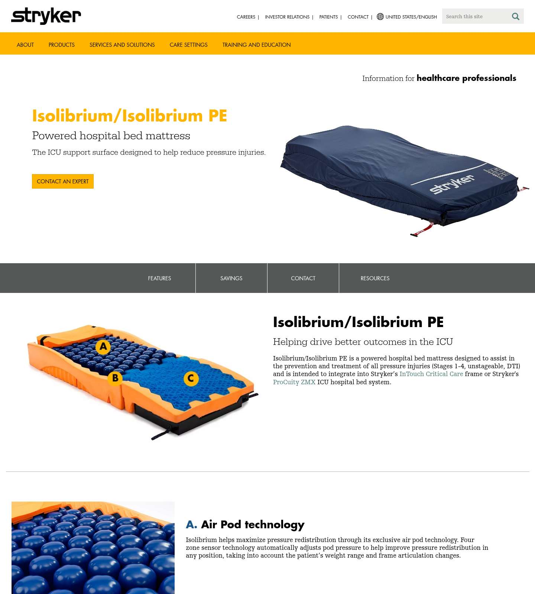{width=8cm} | 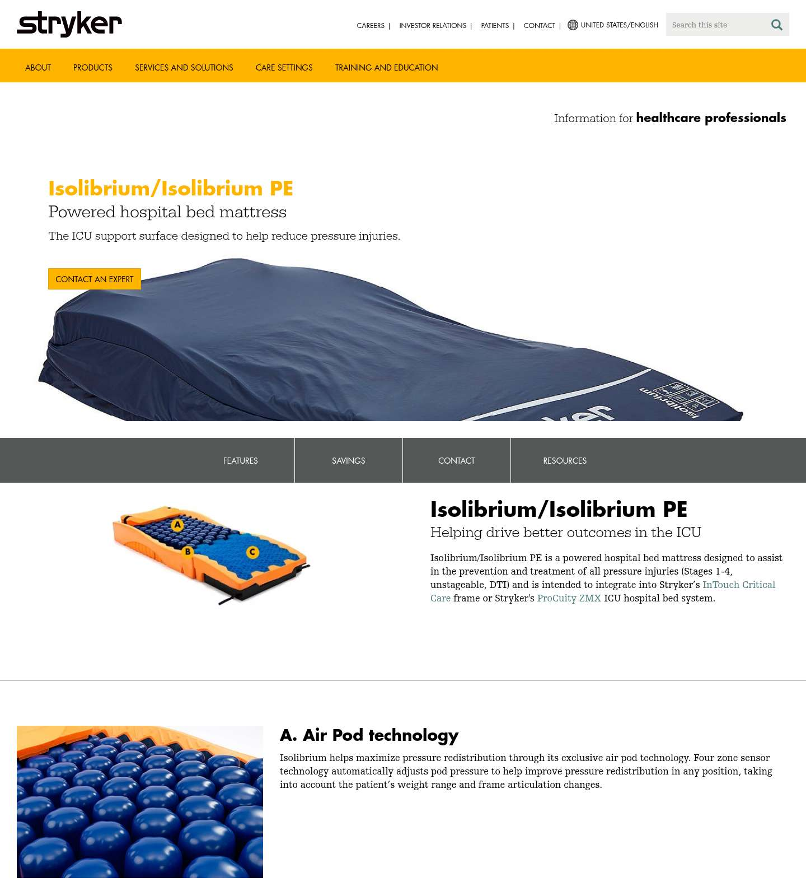{width=8cm} |

| stryker.com (phone, top) | New site | stryker.com (whole page) | New site |
|---|---|---|---|
| 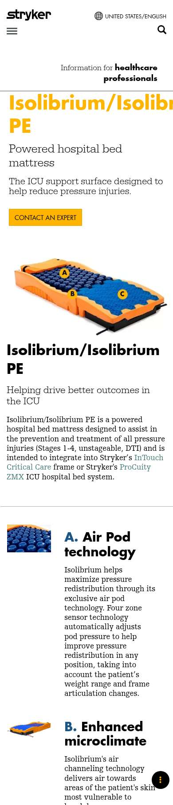{height=9cm} | 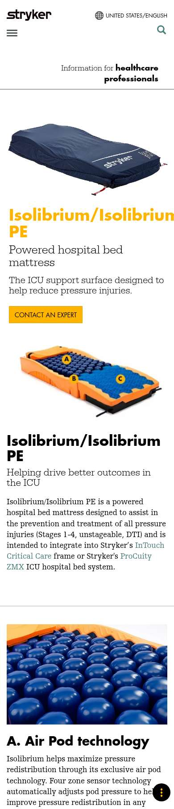{height=9cm} | 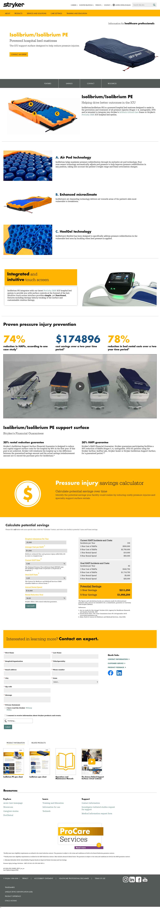{height=9cm} | 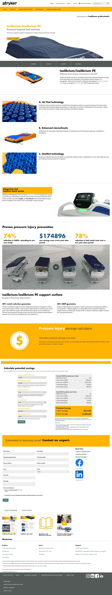{height=9cm} |

**What the customer sees:** the same page, section for section: banner, jump bar, the three feature
rows, the numbers, the video, the calculator, the contact form and the resources. The visible
differences are the banner image (full width instead of the right half) and the larger Quick links
icons.

# 3. LIFEPAK 35

| Section on stryker.com | New site | Result |
|---|---|---|
| Top banner: title, subline, description, gold button, product image | Hero image slide | text sizes, colours and gold button match (fixed in this test); **image fills the slide** (stryker.com: right half) — gap |
| Jump bar | Sticky navigation | match |
| Built on a legacy of trust + 3 icon items | Cards, three per row | match; icons above the text (stryker.com: beside it; no block inside a block) |
| Carousel: 3 slides, headline in a purple box | Carousel of Hero slides, purple gradient box | match (box fixed in this test) |
| 3 feature rows: image + title + list | Columns, narrow + wide | match (title size fixed in this test) |
| A monitor built for your needs + video | Columns, two equal | match |
| FAQ (5 questions) | Accordion | match |
| Contact an expert + form + Quick links | Panel + Marketo form + Quick links fragment | match; **"Have feedback…" line above the form and the document code M0000014366 REV AA missing**; Quick links icons oversized — gaps |
| Tabs: information, videos, related | Tabs | match |
| Resources links (4 columns) | Cards, text | **3 + 1 columns** — shared fragment gap |
| References | Disclaimer section | match; "References:" bold font (convention) |

| stryker.com (1,440px, top) | New site |
|---|---|
| 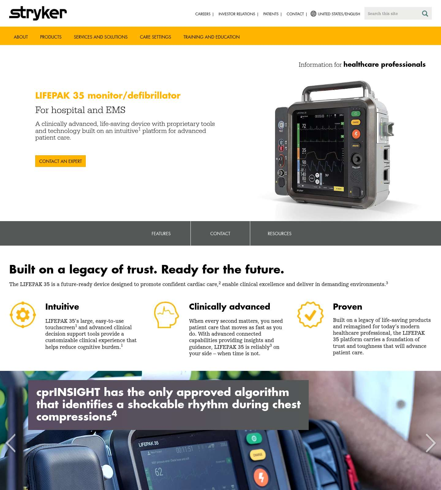{width=8cm} | 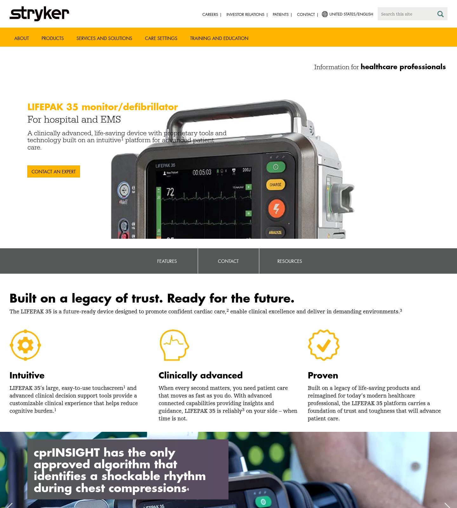{width=8cm} |

| stryker.com (phone, top) | New site | stryker.com (whole page) | New site |
|---|---|---|---|
| 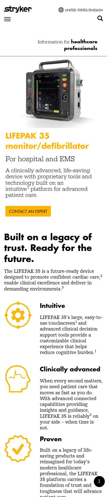{height=9cm} | 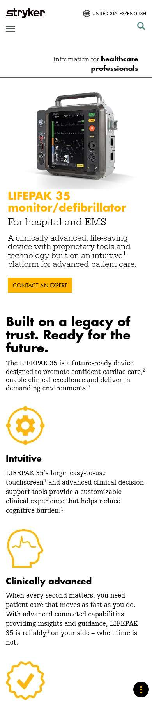{height=9cm} | 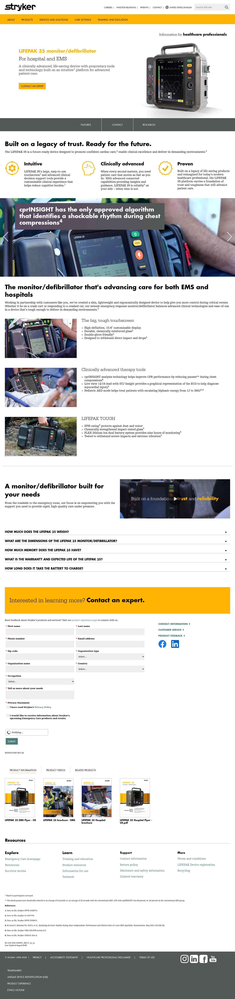{height=9cm} | 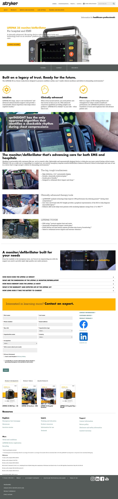{height=9cm} |

**What the customer sees:** the closest of the three: 99% of the text as on stryker.com, the carousel,
accordion and tabs working, the same order and colours. Two short texts near the form are missing.

# 4. SafeAir smoke evacuation

| Section on stryker.com | New site | Result |
|---|---|---|
| Page intro: title, subtitle, text, gold button, product image | Columns, two equal | match; headlines 4% → XL 4.5% (by design); **"SafeAir" Futura bold shows as serif bold** — gap |
| Jump bar | Sticky navigation | match |
| Overview: 4 facts with icons | Cards | match; bold words Futura instead of Humanist (convention) |
| Learn how it works + YouTube video | Columns, two equal | match |
| SafeAir compact smoke evacuator (gold title box) | Gold headline section | match; **box full width** (stryker.com: half) — gap |
| Features image + A–F list in a white box | Columns, wide + narrow, white box with shadow | match |
| Designed for safety (gold box) + 3 columns | Gold headline section + Cards, text | match; title words serif/Futura mix — gap |
| Testimonial (grey band) | Light grey full-width section | background matches; **quote 24.5px → 14px, attribution serif 21px → 14px** — gap |
| SafeAir Pencils: 2 tabs, feature boxes, table | Tabs + Columns (white boxes) + Table | match |
| SafeAir Accessories: 5 tabs | Tabs + Columns (white boxes) | match |
| Product information: resources + 4 videos | Tabs + Cards (resources, video) | match; **videos 3 + 1 per row** (stryker.com: 4) — gap |
| Related products | Cards, teaser | match |
| Contact + form + Quick links and social icons | Marketo form beside the fragment | match; **social icons oversized** — shared fragment gap |
| Resources links | Columns, three equal | match |
| Disclaimer | Disclaimer section | match |

| stryker.com (1,440px, top) | New site |
|---|---|
| 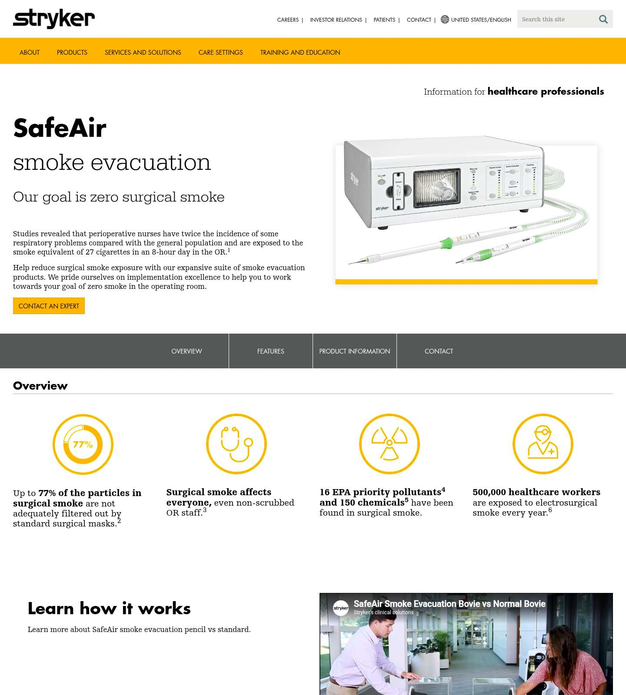{width=8cm} | 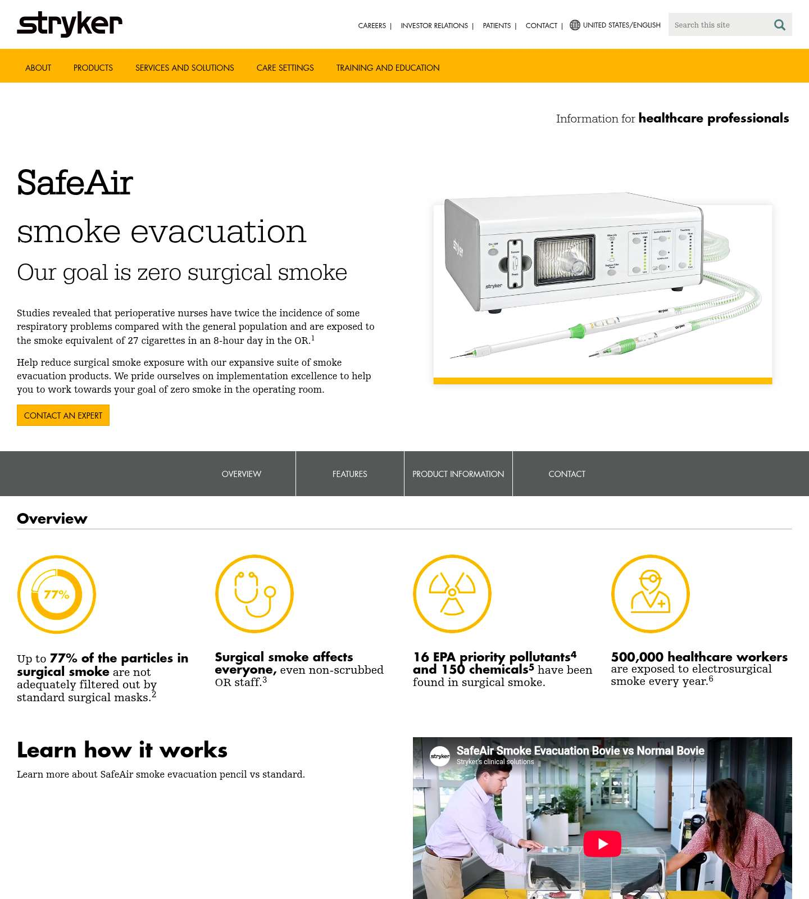{width=8cm} |

| stryker.com (phone, top) | New site | stryker.com (whole page) | New site |
|---|---|---|---|
| 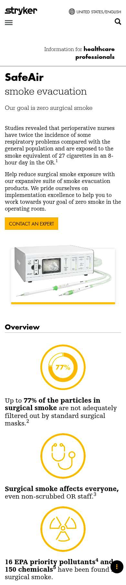{height=9cm} | 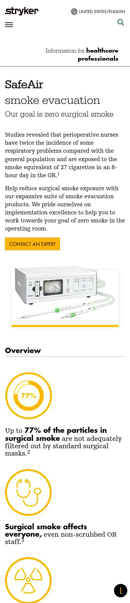{height=9cm} | 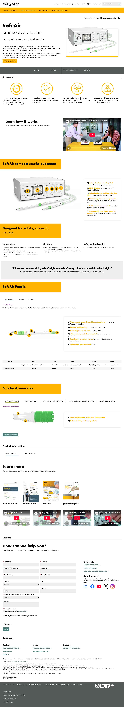{height=9cm} | 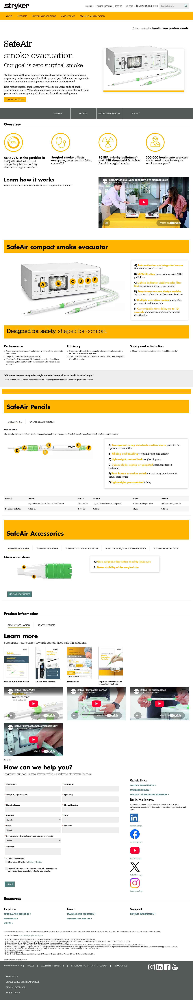{height=9cm} |

**What the customer sees:** the longest page (22 blocks, 3 tab sets, a table) in the same order and
layout. Headlines are one step larger (the standard sizes); the testimonial text and two title words
need a migration fix.

# 5. Fixed during this test

All in the migration's review build or on review pages only; real pages are unchanged.

| What | Effect | Where |
|---|---|---|
| Rows of AEM's responsive grid inside shared fragments become Columns | Isolibrium's feature rows side by side; LIFEPAK's icon items as one row of three cards | migration (sections) |
| A heading's size from its stryker.com size span is kept as Text style | LIFEPAK's 1.25× headings, Isolibrium's "Stryker's Financial Guarantees" | migration (article, sections) |
| A slide's headline box in a rich text is read before the page steps remove it | LIFEPAK's purple carousel boxes with white text | migration (sections, hero) |
| A slide's description paragraph is kept | the line under the banner title on Isolibrium and LIFEPAK | migration (hero slide) |
| A gold slide button is a Bold + Italic link (authoring conventions: gold) | gold "Contact an expert" | migration (hero slide) |
| A sized bold title line in a banner counts from 14px, as on stryker.com | LIFEPAK title 28px (was 49px) | Hero (review pages) |
| An icon-sized card image keeps its own size | LIFEPAK's 90px icons (were full card width) | Cards (review pages) |

# 6. Open gaps (to fix in the migration or decide)

| Gap | Pages | Proposal |
|---|---|---|
| Product-page banners put the image in the right half (stryker.com grid offset 6 of 12); the new site fills the slide | Isolibrium, LIFEPAK 35 | read the slide's grid position in the migration and use the *Page intro* layout (title and image side by side) — to approve |
| Shared fragments are older imports (oversized social icons, Resources columns wrapping) | all three | re-import the shared fragments with today's migration |
| Headline box (gold) half width on stryker.com | SafeAir | a *narrow* headline box choice, or the standard full width — to decide |
| A heading in a box loses its size and mixed fonts | Isolibrium | migration: keep the sizes inside line boxes |
| Futura bold words inside a serif line show as serif bold | SafeAir | migration: mark stryker.com's Futura words (sans) inside serif lines |
| Bold words in running text: Futura bold (new site) vs Humanist bold (stryker.com) | all three | authoring convention: decide which bold applies in sentences |
| Testimonial in a box loses its sizes | SafeAir | migration: Text style on the box's text |
| Video cards: 4 per row on stryker.com, 3 + 1 on the new site | SafeAir | migration: write *Cards per row* for video rows |
| "Have feedback…" line and document code not migrated | LIFEPAK 35 | migration: keep the form's intro text and the document code |
| ProCare Services banner not migrated | Isolibrium | open decision: ProCare tiles as page metadata or authored cards |
| Whole-section text styles still written as section styles (p-1-25, h2-1-5, h-serif, spacer …) | all three | migration: move them to Text style, as the block cells already are |
